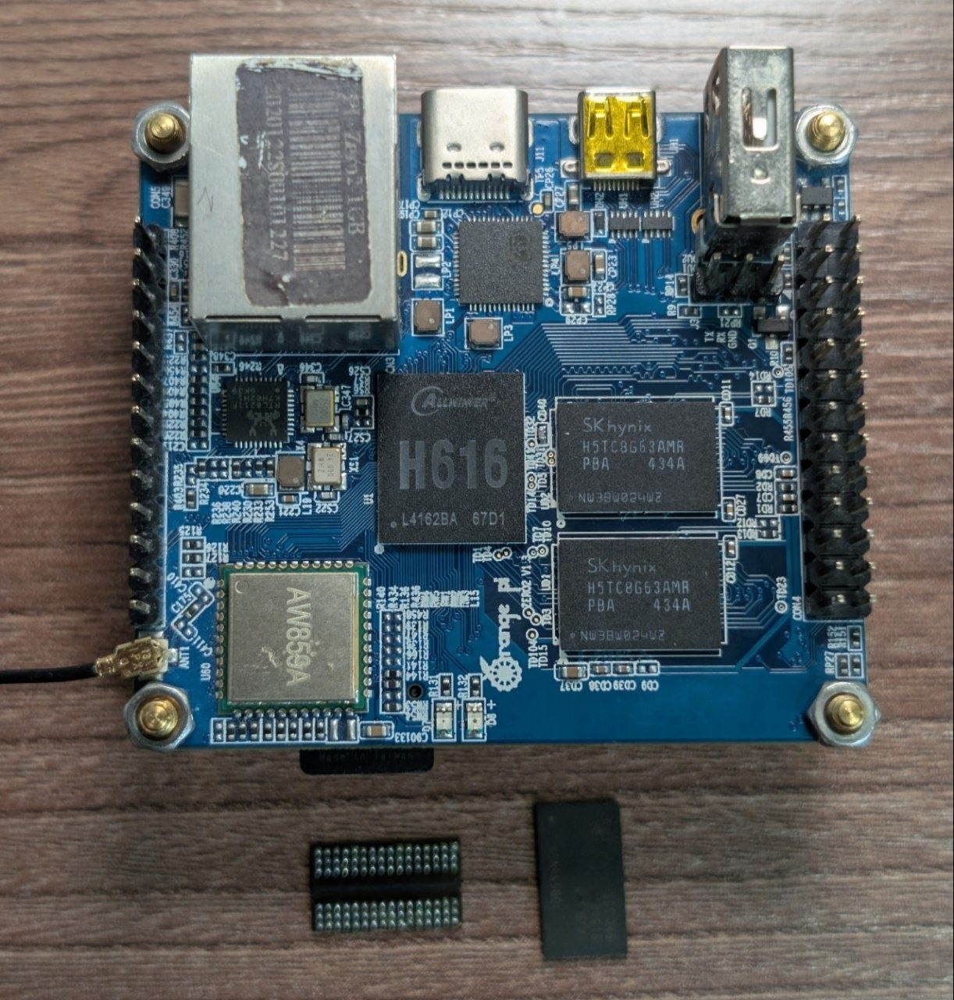

# Orange Pi Zero 2 — 2GB Dual-Rank DDR3L Upgrade & OS Builder

[-success)](#)
[](#)
[](#)
[](#)

U-Boot DRAM PHY patches and a reproducible Docker build environment for running an **Orange Pi Zero 2** (Allwinner H616) upgraded to **2GB RAM** using Dual-Rank (DDP) 8Gb x16 DDR3L memory chips.

> [!CAUTION]
> **Disclaimer — Proceed at Your Own Risk**
> This repository documents a personal hardware/software modification and is provided strictly for educational purposes. It is **not** a call to action. Upgrading BGA memory requires proper SMD/BGA rework equipment and soldering skills. **Note that the PCB solder mask on this board proved to be quite delicate**, so desoldering, pad cleanup with solder wick, and hot-air rework must be performed very gently and carefully to avoid scratching the mask or lifting pads. **Everything you do is entirely at your own risk** — the author bears no responsibility for damaged PCBs, lifted pads, overheated SoCs/DRAM, or bricked devices.


*Orange Pi Zero 2 (PCB rev v1.3) upgraded to 2 GB RAM with two SK Hynix `H5TC8G63AMR-PBA` Dual-Rank DDR3L chips alongside the original desoldered chips.*

---

## 1. Technical Overview & Upgrade Challenge

The **Orange Pi Zero 2** ships from the factory with either **512 MB** (2× 2Gb) or **1 GB** (2× 4Gb) of DDR3 RAM across two 96-ball FBGA footprints (`UD1` on `DQ0–15` and `UD2` on `DQ16–31`), forming a 32-bit data bus.

Upgrading the board to **2 GB (2048 MB)** requires replacing both chips with **8Gb (512M × 16) FBGA-96 DDR3/DDR3L** modules. This modification was performed and verified on **PCB revision v1.3**. When using **Dual-Rank (Dual-Die Package / DDP)** 8Gb chips, two technical requirements must be met:

1. **Hardware (PCB Routing)**: Each DDP package internally stacks two independent 4Gb (256M × 16) dies (`15 rows A0–A14`, `10 columns A0–A9`, `8 banks`). Die 0 is controlled via Rank 0 signals (`CS0#`, `CKE0`, `ODT0`, `ZQ0`) and Die 1 via Rank 1 signals (`CS1#`, `CKE1`, `ODT1`, `ZQ1`).
   * The **Orange Pi Zero 2 PCB** (tested on **v1.3**, also confirmed in the official **v1.5** schematic) routes all Dual-Rank signals from the Allwinner H616 SoC to both `UD1` and `UD2`: `SCS0`/`SCS1` (balls `L2`/`L1`), `SCKE0`/`SCKE1` (balls `K9`/`J9`), `SODT0`/`SODT1` (balls `K1`/`J1`), and populates all four 240Ω 1% `ZQ` calibration resistors (`RD1–RD4` on balls `L8`/`L9`).
   * The PMIC (`AXP305`) supplies `1.5V` on `VCC-DRAM` (`dcdcd`), so `1.35V` DDR3L chips must be backward-compatible with `1.5V` operation (standard per JEDEC DDR3L spec).

2. **Bootloader (Allwinner H616 U-Boot DRAM PHY Driver)**:
   * Stock U-Boot (`v2021.10-sunxi`, `arch/arm/mach-sunxi/dram_sun50i_h616.c`) fails to initialize Rank 2 during auto-detection and falls back to Single-Rank (1024 MB) due to two bugs in the H616 PHY training code:
     * **`mctl_phy_read_calibration()`**: The Rank 2 block calls `setbits_le32(SUNXI_DRAM_PHY0_BASE + 8, 1)` instead of `clrbits_le32(..., 1)` after calibration finishes, leaving the PHY stuck in read calibration mode.
     * **`mctl_phy_read_training()`**: The Rank 2 block writes `2` (Rank 0) instead of `1` (Rank 1) to `SUNXI_DRAM_PHY0_BASE + 0x198`, leaving Rank 1 untrained.
   * Our patch [`0001-h616-support-2gb-dram-for-orangepizero2.patch`](userpatches/u-boot/u-boot-sunxi/0001-h616-support-2gb-dram-for-orangepizero2.patch) fixes both PHY routines, initializes the controller in Dual-Rank mode (`ranks = 2, rows = 15, cols = 10, 32-bit`), and verifies all 2048 MB across four physical boundaries (`0M`, `512M`, `1024M`, `1536M`) during SPL boot.

---

## 2. Compatible Memory Chips

### Tested & Verified (on Orange Pi Zero 2 PCB rev v1.3)
* **SK Hynix `H5TC8G63AMR-PBA`** (`-PBA` 1600 MHz / `-H9A` 1333 MHz / `-G7A` 1066 MHz)
  * Organization: 8Gb DDR3L Dual-Die Package (2× 4Gb dies, 512M × 16, FBGA-96)
  * Geometry: `ranks = 2`, `rows = 15 (A0–A14)`, `cols = 10 (A0–A9)`, `banks = 8 (BA0–BA2)`
  * Voltage: `1.35V` (1.5V backward-compatible)

### Theoretically Compatible Dual-Rank (DDP) 8Gb ×16 Chips
Any JEDEC-compliant **Dual-Rank (2-rank DDP) 512M × 16 FBGA-96 DDR3/DDR3L** chip rated for $\ge 1333\text{ MT/s}$ (648 MHz clock on H616) and 1.5V operation uses the same pinout and geometry (`ranks = 2, rows = 15, cols = 10`):
* **Samsung**: `K4B8G1646B-MYK0` / `K4B8G1646D-MYK0` (DDP 2-rank revisions)
* **Micron**: `MT41K512M16HA` / `MT41J512M16` (Dual-Die revisions with `CS1#`, `CKE1`, `ODT1`, `ZQ1` active)
* **Nanya**: `NT5CC512M16` Dual-Die variants

> [!NOTE]
> **Single-Rank (Monolithic) 8Gb ×16 Chips (e.g., SK Hynix `H5TC8G63CMR`, Samsung `K4B8G1646Q`)**:
> Monolithic 8Gb ×16 chips use **1 rank and 16 row bits (`A0–A15` on ball `M7`)**. Since the Orange Pi Zero 2 PCB also routes `SA15` (ball `M7` $\to$ SoC `U18`), monolithic chips can be used by changing `para.ranks = 1; para.rows = 16;` in the U-Boot patch.

---

## 3. Boot Output & Memory Verification

### SPL Early Memory Check
```text
U-Boot SPL 2021.10-orangepi
DRAM: Initializing Dual-Rank 2048 MB (ranks=2, 32-bit, rows=15, cols=10)...
DRAM test: [0M]=0x11111111 [512M]=0x22222222 [1024M]=0x33333333 [1536M]=0x44444444
DRAM: SUCCESS! Full 2048 MB dual-rank verified without aliasing!
DRAM: Initialized 2048 MB (ranks=2, 32-bit, rows=15, cols=10)
 2048 MiB
```

### Stress Testing in Linux
Once booted into Ubuntu 22.04 (Linux 6.1 LTS):
```bash
free -h
sudo apt update && sudo apt install -y memtester
sudo memtester 1800M 1
```
*(Allocating `1800M` tests ~90% of physical RAM across both ranks while leaving ~200 MB for the running Linux kernel and system services).*

---

## 4. Building Firmware (Docker)

All builds run inside an isolated Ubuntu 22.04 Docker container without modifying the host system. Upstream sources (`orangepi-build`, U-Boot, Linux 6.1) are cloned automatically during the build.

### Prerequisites
* Linux host (`x86_64`) with **Docker** installed
* ~25 GB free disk space (for a full OS image build)

### 1. Configure User Credentials (Optional)
Default credentials are **`ubuntu` / `ubuntu`** (with `sudo` access and serial autologin configured). To customize them before building:
```bash
cp .env.example .env
# Edit DEFAULT_USERNAME, DEFAULT_PASSWORD, ROOT_PASSWORD in .env
```

### 2A. Build Only U-Boot + SPL (~1–2 minutes)
Builds `u-boot-sunxi-with-spl.bin` in the project root to upgrade an existing SD card:
```bash
./scripts/build_uboot.sh
```
Flash to an existing MicroSD card at the 8 KB offset:
```bash
sudo dd if=u-boot-sunxi-with-spl.bin of=/dev/sdX bs=1k seek=8 conv=fsync
```

### 2B. Build Full OS Image (Ubuntu 22.04 Server + Linux 6.1 LTS)
Builds a complete headless server `.img` (includes `wpasupplicant`, `network-manager`, `wireless-tools`, `iw`, and `bluez`):
```bash
./scripts/build_image.sh
```
Flash the image to a MicroSD card:
```bash
sudo dd if=output/Orangepizero2_2GB_ubuntu_jammy_server_linux6.1.31.img of=/dev/sdX bs=4M status=progress conv=fsync
```

---

## 5. GitHub Actions CI/CD & Automated Releases

The workflow in [`.github/workflows/build.yml`](.github/workflows/build.yml) provides automated cloud builds and release publishing:
* **On Push (`main`/`master`)**: Compiles `u-boot-sunxi-with-spl.bin` (+ `.sha256`) and uploads it as a workflow artifact.
* **On Version Tag Push (`v*`, e.g., `v1.0.0`)**: Automatically builds **both** `u-boot-sunxi-with-spl.bin` and the full Ubuntu 22.04 + Linux 6.1 LTS image (`Orangepizero2_2GB_ubuntu_jammy_server_linux6.1.31.img.xz` + `.sha256`), creates a **GitHub Release**, and attaches all binaries directly to the Release page:
  ```bash
  git tag v1.0.0
  git push origin v1.0.0
  ```
* **On Manual Dispatch (`workflow_dispatch`)**: Allows selecting the build target (`uboot`, `image`, or `all`), custom user credentials, and an optional `release_tag` to publish a GitHub Release directly from the Actions UI.

---

## 6. Repository Structure

```text
├── .env.example                                      # Template for custom user & build settings
├── .github/workflows/build.yml                       # GitHub Actions CI/CD pipeline
├── .gitignore                                        # Excludes upstream sources and build artifacts
├── assets/
│   └── orangepi-zero2-v1.3-2gb-mod.jpg               # Photo of the upgraded PCB rev v1.3
├── docker/Dockerfile                                 # Isolated Ubuntu 22.04 build container
├── docker-compose.yml                                # Docker Compose service definition
├── scripts/
│   ├── build_image.sh                                # Builds the full OS .img inside Docker
│   ├── build_uboot.sh                                # Builds standalone u-boot-sunxi-with-spl.bin
│   ├── clone_repo.sh                                 # Clones official orangepi-build (shallow)
│   ├── fetch_cache.sh                                # Pre-fetches build caches
│   └── setup_patches.sh                              # Injects patches and user config into build tree
├── userpatches/
│   ├── config-orangepizero2-2gb.conf                 # Board build profile (Jammy, Linux 6.1 next)
│   ├── customize-image.sh                            # Chroot hook for user setup & systemd autologin
│   └── u-boot/u-boot-sunxi/
│       └── 0001-h616-support-2gb-dram-for-orangepizero2.patch # Dual-Rank 2GB DRAM fix for H616
└── README.md
```

---

## Acknowledgments

* Special thanks to **Shenzhen Xunlong Software Co., Ltd. (Orange Pi)** for supporting their boards, publishing open hardware schematics and documentation, and maintaining the open-source [`orangepi-build`](https://github.com/orangepi-xunlong/orangepi-build) system and kernel/U-Boot repositories.
* Hardware reverse engineering, U-Boot DRAM driver debugging, and build automation were assisted by **Antigravity CLI**, **Gemini 3.8**, and **Gemini Argon**.
